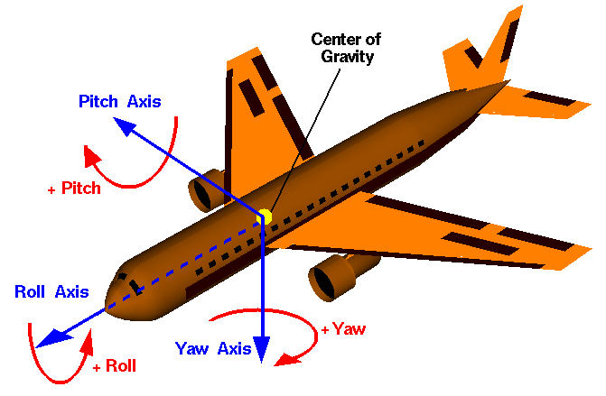
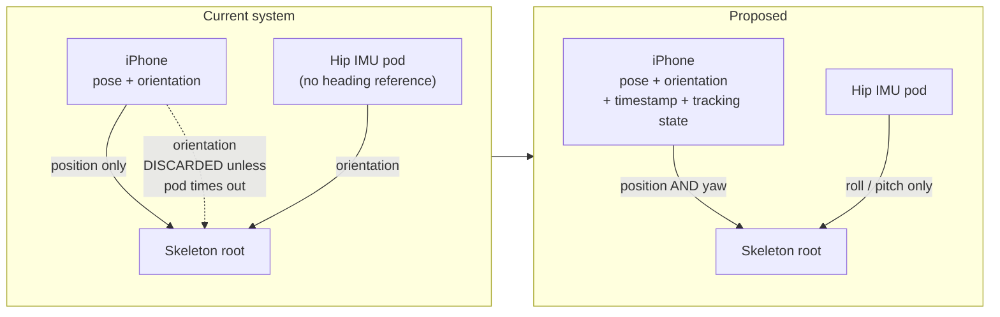
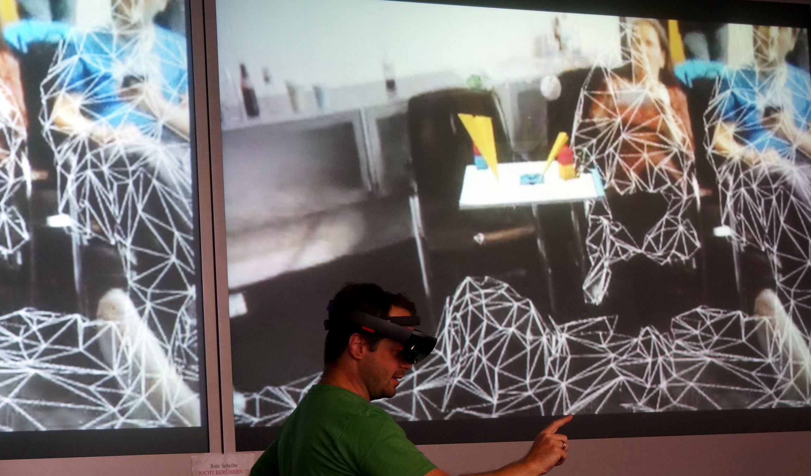
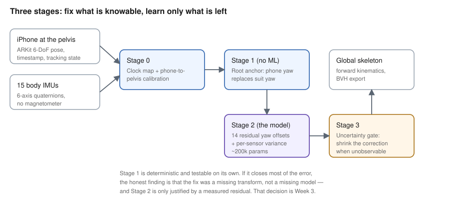
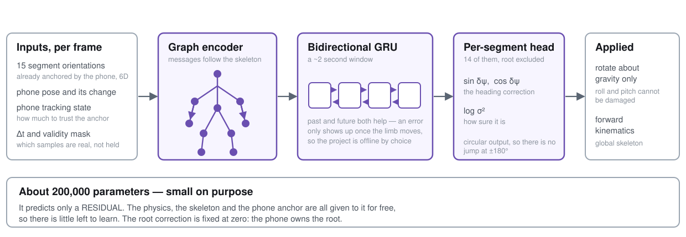
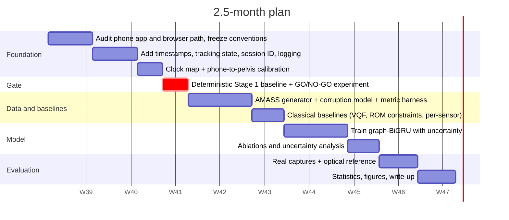

# Root-Anchored Yaw Correction for a Magnetometer-Free Motion-Capture Suit

### Using an iPhone's visual–inertial pelvis pose and a small skeleton-aware network to remove global heading drift

**Danyal Khorami** · Machine Learning · Project Proposal · 2.5-month scope

---

## 1. What this project is

Mesquite is a 15-node wearable motion-capture suit. Each node measures its own orientation. A
hip-mounted iPhone separately tracks where the body is in the room using ARKit's camera + IMU
tracking.

The suit reconstructs a **good pose** and puts it in the **wrong place**. Limbs are correct relative
to each other; the whole body faces the wrong direction, and that direction wanders.

**This project is a method for removing that global heading error**, built from three pieces:

1. a deterministic fix that uses the phone's visual heading to anchor the pelvis — *this is not ML,
   and it has to be done first*;
2. a **small** neural network (~200k parameters) that estimates the leftover per-segment heading
   errors that remain after the anchor is applied;
3. an uncertainty output that lets the system **stop correcting** when the motion does not actually
   reveal the answer, instead of confidently inventing one.

**The iPhone app is a prerequisite, not the project.** The contribution is the correction method and
the evidence about when learning helps and when it does not.

---

## 2. The problem

### 2.1 Why the error exists



*Roll, pitch and yaw axes. NASA Glenn Research Center — public domain, via
[Wikimedia Commons](https://commons.wikimedia.org/wiki/File:Rollpitchyawplain.png).*

An accelerometer measures **gravity**, which always points downward.

- **Roll** — tilting left or right *changes* how gravity appears to the sensor.
- **Pitch** — tilting forward or backward also *changes* gravity's measured direction.
- **Yaw** — turning horizontally about the vertical axis **does not change** the direction of gravity.

Therefore gravity corrects **roll and pitch**, but provides **no information about yaw** [1]. Without
a magnetometer, a camera, or another external reference, yaw drifts.

So every one of the 15 sensors boots at an arbitrary heading and then wanders independently. There is
nothing in the sensor that can fix it.

The magnetometer stays off deliberately: a capture volume has steel framing, cabling and 15
transmitting radios, and magnetic distortion routinely produces *confidently wrong* heading that
changes with position in the room.

### 2.2 What we measured

From a three-phase audit of this system (`system_assessment/`, `system_assessment_2/`,
`system_assessment_3/`):

| Observation | Evidence quality |
|---|---|
| Global joint orientation error is roughly **3× worse** than root-relative pose error | `[fact-data]` — a within-file ratio, robust |
| Error is **near-uniform across every joint including the root** | `[fact-data]` — the signature of a whole-body frame error, not per-limb estimation error |
| Session-to-session heading alignment **changes sign** (one session needs a large negative rotation, the next a large positive one) | `[fact-data]` — the signature of an arbitrary *origin*, not of drift |
| Absolute magnitudes (≈42–54° global vs ≈15–16° root-relative, −71°/+99° alignment) | **Recompute before quoting.** The comparison suit was itself inertial and shares the failure mode; the old exports also carried a ~6.7% timing dilation |

The *pattern* is solid. The *numbers* need re-measurement with a proper reference — which is why
Section 7 requires optical ground truth for any absolute claim.

### 2.3 The finding that changes the plan

I traced the browser's fusion code. The iPhone's orientation **is already on the wire and is being
thrown away**:

- [`js/custom_icm.js:603-615`](js/custom_icm.js#L603-L615) — `HipsAlt` (the **hip IMU pod**) is
  preferred and overwrites the skeleton root's orientation.
- [`js/custom_icm.js:582`](js/custom_icm.js#L582) — the phone's orientation is applied **only** when
  the hip pod has been silent for more than one second. It is a fallback.
- [`js/custom_icm.js:931`](js/custom_icm.js#L931) — the phone supplies **position only**
  (`px, py, pz`), scaled by a constant, with no camera-to-hip lever-arm correction.
- Same line — the position guard is `obj.px && obj.py && obj.pz`, a **truthiness test**, so a
  coordinate of exactly `0` (which is where a session origin sits) silently drops the frame.



**So the single external heading reference in the system is currently unused as a heading
reference.** That is a real, cheap, deterministic fix — and it has to be done and measured *before*
any model is trained, or the model would be paid to fix something a coordinate transform already
solves.

### 2.4 How the phone gets a heading at all

Worth stating explicitly, because it is the assumption the whole project rests on.



*A head-worn AR device building a live mesh of the room around it. Kai Kowalewski, CC BY-SA 4.0, via
[Wikimedia Commons](https://commons.wikimedia.org/wiki/File:MicrosoftHoloLensRoomScan.JPG) (cropped).
The iPhone does the same with its camera and IMU.*

ARKit's world tracking is **visual–inertial odometry**. The camera looks *outward* and extracts feature
points from fixed geometry — walls, furniture, floor texture — and builds a map of where they are. As
the wearer walks, the same geometry is re-observed from new angles and the device corrects its own
position and orientation every frame. Between camera frames the IMU is integrated at high rate.

**How that becomes a heading for us:**

1. From the map, the phone knows **its own pose in the room**.
2. We want **one number**: the rotation about the vertical axis — the heading.
3. The phone is rigidly mounted to the pelvis, so phone heading composed with the mount calibration
   gives the **pelvis heading in the room**, `ψ_phone`.
4. That is the **global heading** — the only measurement in the system tied to anything outside the
   body.

The two are complementary in exactly the way we need:

| | Fast | Drifts |
|---|---|---|
| Gyroscope | yes | **yes** — nothing corrects it |
| Camera | no | **no** — the room does not move |

**That is the entire difference between the phone and the 15 body sensors.** The body sensors have the
same gyroscope problem and no camera, so nothing bounds their heading error. The phone has something
to measure against.

Three qualifications that shape the design:

- **It is not north.** With `.gravity` world alignment, Y is along gravity and the horizontal axes are
  fixed by the device pose at session start. Heading is **session-relative with an arbitrary origin**,
  but stable thereafter — which is sufficient, because we need a *consistent* reference, not a
  geographic one. (If the app instead requests `.gravityAndHeading`, it aligns to true north **via the
  magnetometer**, which would contradict this project's premise. §10 makes this a week-one check.)
- **Drift is bounded, not zero,** and relocalisation produces *discrete jumps* rather than smooth error.
- **Tracking degrades predictably** — blank walls, dim light, a covered camera, fast rotation.
  `ARCamera.trackingState` reports `.normal`, `.limited(reason)` or `.notAvailable`, with reasons
  including `.initializing`, `.excessiveMotion`, `.insufficientFeatures` and `.relocalizing` [19].

The third point is why tracking state must be on the wire (§4 Stage 0) and why the model predicts its
own confidence (§4 Stage 3): the anchor is good, but it is not always available, and the system has to
know the difference.

One convenient asymmetry: **VIO constrains rotation far better than translation**, and rotation is
exactly what we are taking from it.

---

---

## 3. Possible solutions, and what I picked

| # | Approach | What it gives | Why not (or why yes) |
|---|---|---|---|
| A | **Turn the magnetometer on** | True Earth heading | Rejected. Needs per-chip hard/soft-iron calibration and is unreliable in exactly this environment. It is also the thing the project exists to avoid. |
| B | **Better single-sensor filter** (e.g. VQF [2]) | Cleaner roll/pitch, bias handling | Necessary hygiene, **not sufficient**: no 6-axis filter can manufacture a yaw reference [1]. Kept as a preprocessing baseline. |
| C | **Classical kinematic constraints** — joint range-of-motion, hinge-axis, zero-velocity updates [3] | Relative heading between *connected* segments under informative motion | Strong, magnetometer-free, and a **required baseline**. Limited: needs idealized joint models, hand-tuned gating, and fails on static or symmetric motion. |
| D | **Add a room camera / OptiTrack / Lighthouse** | Direct room-referenced pose | Solves it, but it is infrastructure, not a method. Kept as *ground truth*, not as the solution. |
| E | **Add an AprilTag board** [4] | Repeatable room-frame anchor when visible | Cheap and genuinely useful for recovery after a tracking reset. Held as an optional extension. |
| F | **Use the iPhone's visual–inertial pose as a root anchor** | An external heading reference for the **pelvis**, in the phone's session frame | **Picked as the foundation.** The hardware already exists, is already worn, and the data already reaches the browser. |
| G | **Learn the residual per-segment yaw from body structure** | Corrections for the 14 non-root sensors, which F cannot reach | **Picked as the contribution.** F anchors one segment; the other 14 still drift relative to it. |

**Picked: F + G, in that order, with C as the baseline that G must beat.**

The reasoning is the observability argument. The phone gives the *common* heading of the body. It
says nothing about whether the left forearm's heading has drifted relative to the pelvis. That
residual is what remains, and it is only recoverable from **body structure and motion** — which is a
learning problem.

### Why this is a defensible ML problem

Fifteen orientations with mutually wrong headings produce a pose that is anatomically *implausible*:
legs splayed, torso twisted, arms out of phase with gait. A model trained on large-scale real human
motion learns that plausibility, so the corrections become identifiable by asking which ones make the
pose look like real motion.

There is direct precedent. **VIP** [5] optimizes exactly one vertical-axis heading parameter per IMU
using visual evidence. **HPS** [6] anchors global human motion with a body-worn camera while IMUs
supply articulation. **EgoLocate** [7] fuses a phone camera with sparse IMUs in real time and
explicitly estimates the camera-to-mocap transform, weighting corrections by confidence. The sparse-IMU
pose literature — DIP [8], TransPose [9], PIP [10], TIP [11] — establishes that learned human-motion
priors recover information that is not present in any single sensor.

This project is the intersection those papers leave open: **VIP's per-sensor heading variable, solved
online from a hip-mounted phone anchor instead of an external camera that can see the performer.**

---

## 4. The method



### Stage 0 — Make the two streams comparable (deterministic)

Without this, every later number mixes real body motion with calibration and timing error.

- **Timing.** Fit an affine map per device clock, `t_host = a·t_device + b`, so both offset *and*
  skew are represented. A constant-offset assumption is not enough across 16 independent clocks
  [12]. *The pod side of this was implemented and tested in the Phase 3 firmware work: acquisition
  timestamps, freshness flags and per-node sequence integrity now exist.*
- **Geometry.** Solve the rigid phone→pelvis transform `{}^{C}T_{B_0}` (rotation **and** the
  camera-to-hip lever arm — treating the camera centre as the hip point injects position error every
  time the pelvis rotates).

### Stage 1 — Anchor the root with the phone (deterministic, no ML)

With the phone pose `{}^{W}T_C(t)`, the pelvis pose is

```
{}^{W}T_{B_0}(t) = {}^{W}T_C(t) · {}^{C}T_{B_0}
```

and the common correction applied to every segment is

```
C_0(t) = R^{W}_{B_0}(t) · ( R̄^{I}_{B_0}(t − τ) )ᵀ
R^{W,base}_{B_i}(t) = C_0(t) · R̄^{I}_{B_i}(t − τ)
```

Two variants will be compared empirically rather than assumed: **full SO(3) root substitution** vs
**yaw-only correction about gravity**. Phone and IMU roll/pitch are both gravity-referenced, so the
yaw-only variant may be safer when the phone mount flexes.

**Week 3 is a go/no-go gate.** If Stage 1 closes most of the global error and the residual per-segment
error falls below measurement repeatability, the honest result is *"the defect was a missing
coordinate transform, not a missing model"* — and the ML component pivots (Section 9).

### Stage 2 — Learn the residual (the model)

For each of the 14 non-root segments, predict a rotation about the estimated gravity axis:

```
R^{W,corr}_{B_i}(t) = R_ĝ( δψ_{i,t} ) · R^{W,base}_{B_i}(t),      δψ_{0,t} = 0
```

The root residual is **fixed to zero** — the root is defined by the phone whenever phone tracking is
accepted. The model is only ever asked for the 14 things the phone cannot supply.

### Stage 3 — Know when to stop

The model also outputs a per-sensor log-variance. During a static hold, a symmetric pose, or a phone
tracking loss, the correction is genuinely **not identifiable**, and the right behaviour is to shrink
the correction toward zero rather than guess. This follows the heteroscedastic-uncertainty formulation
of Kendall & Gal [13], and mirrors how EgoLocate [7] and RobustCap [14] confidence-weight visual
evidence.

---

## 5. Tools, model, and architecture — and why

### Architecture



| Choice | Why |
|---|---|
| **Graph encoder over skeleton adjacency** | A forearm's heading error is constrained by its upper arm and hand, not by the opposite foot. Restricting message passing to anatomical edges encodes that and keeps the model small. Ablation: remove edges → dense layer. |
| **Bidirectional GRU, ~2 s window** | The grading target is offline, so future context is free and helps enormously — a heading error only becomes observable once the segment moves. Ablation: causal GRU for the real-time stretch goal. |
| **6D rotation representation** [15] | Quaternions and Euler angles are discontinuous as network outputs; 6D is continuous and trains far more stably. Loss and metrics are still computed on SO(3). |
| **`(sin δψ, cos δψ)` output** | Avoids the wrap discontinuity at ±π. Recover `δψ = atan2(sin, cos)`. |
| **Gravity-axis-only correction** | A rotation about ĝ **provably cannot corrupt roll or pitch**, which are already correct. The model can only touch the broken degree of freedom. |
| **~200k parameters** | Deliberately light. It must run on a laptop in the offline pipeline and be plausible on-device later. This is a *residual* correction with strong physical structure supplied for free — a large model is not the point and would overfit a small real dataset. |
| **PyTorch + PyTorch Geometric** | Standard, and differentiable FK is straightforward to write directly in PyTorch. |

### Loss

```
L = λ_R · L_SO3  +  λ_FK · L_FK  +  λ_U · L_NLL  +  λ_S · L_smooth
```

with geodesic rotation distance `d(R, R̂) = arccos( clip( (tr(Rᵀ R̂) − 1)/2, −1, 1 ) )`.
`L_FK` penalizes joint *position* error after differentiable forward kinematics — because a small
heading error at the pelvis becomes a large position error at the hand, which is what actually
matters. `L_NLL = e²·exp(−s) + s` trains mean and variance jointly [13]. `L_smooth` limits how fast
the *correction* changes, not how fast the body moves.

### On "reinforcement learning" — an honest recommendation

The brief asks for RL to gradually improve the correction. Here is my assessment.

**RL is the wrong tool for the core task.** Wherever ground truth exists (synthetic AMASS data,
optical capture), the correct correction is *known*, which makes this supervised learning. RL would
discard that signal and learn the same thing far more slowly and less stably.

**But the underlying goal is right**, and there are two sound ways to get it:

1. **Self-supervised online adaptation (recommended, in scope).** At deployment there is no ground
   truth, but there *are* free consistency signals: agreement with the phone anchor, foot-contact
   non-slip, joint limits, left/right symmetry over a gait cycle. Adapting the model's last layer
   online to minimize inconsistency is genuinely "gradual improvement without labels" — the
   test-time-adaptation framing [16] rather than the RL one. This is the thing the brief actually
   wants.

2. **A small gating policy (stretch, clearly scoped).** "How much should I trust the phone versus the
   suit *right now*?" is a sequential decision with a delayed, noisy payoff. Formulated as a
   contextual bandit over a handful of discrete trust levels, with reward = negative drift proxy,
   this is a legitimate and *small* RL problem. I would attempt it only after Stages 1–3 are
   measured, and would report it as an extension.

**What I will not do** is train the main corrector with RL and present it as an advance. It would be
slower, less accurate, and harder to defend than the supervised baseline it has to beat.

---

## 6. Data

| Source | Role | Note |
|---|---|---|
| **AMASS** [17] | Training. Place 15 virtual sensors on the skeleton → unlimited data with *exact* labels | The only way to get clean heading ground truth at scale |
| **Corruption model** | Injects the failure modes into AMASS: independent startup yaw offsets, slow per-sensor drift, common root offsets, phone outages and world-frame resets, mount slip, packet gaps, held samples, int16 quantization, timing jitter, and deliberately low-excitation intervals | Distributions come from the instrumentation built in the Phase 3 firmware work — measured, not guessed |
| **TotalCapture** [18] | External test set: video + IMU + optical reference | Different sensor layout; mapped explicitly and reported separately |
| **New Mesquite captures** | Held-out evaluation | Cold starts, 10-min static holds, ±90°/360° turns, walking, sitting, squatting, limb isolation, camera occlusion, dim light, mount slip, forced tracking loss and relocalization |

**Splits are subject-disjoint.** Hyperparameters are tuned on validation subjects only; the test set
is opened once.

---

## 7. Evaluation

**Primary**
- per-segment gravity-axis heading error (degrees)
- per-segment SO(3) geodesic error
- global joint-position RMSE after forward kinematics
- **paired, session-level 95% bootstrap CI** on (baseline − model). The strongest baseline is chosen
  on validation and **frozen before the test set is opened.** The hypothesis is supported only if the
  interval lies above zero.

**Secondary** — yaw-error slope (°/min), 95th-percentile and worst-decile error, largest pose
discontinuity at a tracking reset, recovery time after an outage, uncertainty calibration, and
runtime/latency/memory.

**Ground truth.** Absolute room-frame heading claims require synchronized optical capture (OptiTrack
or Vicon). **Rokoko and the iPhone itself are not independent heading references** — Rokoko is
inertial and shares the failure mode under test. Exactly one registration between the optical room
frame and the phone session frame is permitted, at initialization; per-frame or best-fit alignment
would erase the phenomenon being measured. Without optical access, real trials are reported as a
**case study** and quantitative claims stay on synthetic data.

---

## 8. Timeline — 10 weeks



| Week | Deliverable |
|---|---|
| 1 | Answers to the open questions in §10; frozen frame conventions and message schema |
| 2 | Raw synchronized logging: phone timestamp, tracking state, session ID; pod acquisition time |
| 3 | **Go/no-go gate** — deterministic phone-root baseline measured |
| 4–5 | Synthetic generator, corruption model, metric harness |
| 6 | Classical + per-sensor baselines, frozen |
| 7–8 | Graph-BiGRU trained; ablations |
| 9 | Real captures with optical reference |
| 10 | Statistics, failure analysis, paper |

Weeks 1–3 are the risky part and they are deliberately front-loaded: if the phone does not transmit
orientation and timestamps, everything downstream stalls, and I need to know that in week 1, not
week 7.

---

## 9. Risks and honest pivots

| Risk | Pivot |
|---|---|
| **Stage 1 alone fixes most of the error** | That is a *publishable negative result*: the defect was a missing transform, not a missing model. Pivot the ML to phone-tracking-reliability classification or missing-sample reconstruction on the same data. |
| **The phone sends position but not orientation** | Add it in week 1. Position alone cannot supply a rotation — this is a blocker, not a workaround. |
| **No optical ground truth available** | Keep quantitative claims on synthetic data; report real trials as a case study. Do not claim real absolute-heading accuracy. |
| **The phone slips relative to the pelvis** | Rigidly co-mount the phone with the hip IMU, or model mount slip as an explicitly identified state. Do not ask the network to hide a mechanical problem. |
| **Sim-to-real gap** | Corruption distributions are calibrated from real instrumentation; fine-tune on real captures; report synthetic and real separately and never merge them. |
| **Residual per-segment yaw is below measurement noise** | Report it as such. A bound on the residual is a result. |

---

## 10. Questions to answer in week 1

**Phone.** Native ARKit or a WebXR wrapper? Which `worldAlignment` — `.gravity` or
`.gravityAndHeading`? (The latter *uses the magnetometer*, which would contradict the project's
premise and must be checked, not assumed [19].) Does the message carry the full transform or only
position? Does it carry `ARFrame.timestamp`, `ARCamera.trackingState`, session ID, and
reset/relocalization events [19]?

**Mechanics.** Is the phone rigidly co-mounted with the hip IMU? What are the phone→pelvis rotation
and lever arm, and how are they measured?

**Conventions.** Handedness, axis order, quaternion component order at every stage.

**Evaluation.** Is OptiTrack/Vicon available? Is repeatable *room-relative* heading sufficient, or is
geographic north actually required?

---

## 11. Expected contribution

1. An explicit, synchronized method for anchoring a magnetometer-free suit to a phone's
   visual–inertial pelvis pose — the transform the current system is missing.
2. A **light**, uncertainty-aware model that corrects only the residual segment headings that become
   inferable after that anchor exists.
3. A benchmark that separates initialization offset, common yaw drift, differential sensor drift,
   tracking reset, mount slip and timing error — which the current evaluation cannot do.
4. Evidence about **when a deterministic solution is enough and when learned body structure adds
   measurable value.**

The project is useful whichever way the hypothesis falls. A negative result establishes that the
error was a missing frame transform rather than something needing a neural network — which is worth
knowing, and is currently unknown.

---

## References

1. Kok, Hol, Schön. *Using Inertial Sensors for Position and Orientation Estimation.* Foundations and Trends in Signal Processing, 2017. — observability of orientation from inertial sensors.
2. Laidig, Seel. *VQF: Highly accurate IMU orientation estimation with bias estimation and magnetic disturbance rejection.* Information Fusion, 2023.
3. Laidig, Lehmann, Seel. *Magnetometer-free realtime inertial motion tracking by exploitation of kinematic constraints in 2-DoF joints.* IEEE EMBC, 2019.
4. Olson. *AprilTag: A robust and flexible visual fiducial system.* IEEE ICRA, 2011.
5. von Marcard, Henschel, Black, Rosenhahn, Pons-Moll. *Recovering Accurate 3D Human Pose in The Wild Using IMUs and a Moving Camera (VIP / 3DPW).* ECCV, 2018. — per-IMU vertical-axis heading optimization.
6. Guzov, Mir, Sattler, Pons-Moll. *Human POSEitioning System (HPS): 3D Human Pose Estimation and Self-localization in Large Scenes from Body-Mounted Sensors.* CVPR, 2021.
7. Yi et al. *EgoLocate: Real-time Motion Capture, Localization, and Mapping with Sparse Body-mounted Sensors.* ACM SIGGRAPH, 2023.
8. Huang, Kaufmann, Aksan, Black, Hilliges, Pons-Moll. *Deep Inertial Poser: Learning to Reconstruct Human Pose from Sparse Inertial Measurements in Real Time.* ACM SIGGRAPH Asia, 2018.
9. Yi, Zhou, Xu. *TransPose: Real-time 3D Human Translation and Pose Estimation with Six Inertial Sensors.* ACM SIGGRAPH, 2021.
10. Yi et al. *Physical Inertial Poser (PIP): Physics-aware Real-time Human Motion Tracking from Sparse Inertial Sensors.* CVPR, 2022.
11. Jiang et al. *Transformer Inertial Poser: Real-time Human Motion Reconstruction from Sparse IMUs with Simultaneous Terrain Generation.* ACM SIGGRAPH Asia, 2022.
12. Qin, Shen. *Online Temporal Calibration for Monocular Visual-Inertial Systems.* IEEE/RSJ IROS, 2018.
13. Kendall, Gal. *What Uncertainties Do We Need in Bayesian Deep Learning for Computer Vision?* NeurIPS, 2017.
14. *RobustCap: Fusing Monocular Images and Sparse IMU Signals for Real-time Human Motion Capture.* ACM SIGGRAPH Asia, 2023.
15. Zhou, Barnes, Lu, Yang, Li. *On the Continuity of Rotation Representations in Neural Networks.* CVPR, 2019.
16. Wang, Shelhamer, Liu, Olshausen, Darrell. *Tent: Fully Test-Time Adaptation by Entropy Minimization.* ICLR, 2021.
17. Mahmood, Ghorbani, Troje, Pons-Moll, Black. *AMASS: Archive of Motion Capture as Surface Shapes.* ICCV, 2019.
18. Trumble, Gilbert, Malleson, Hilton, Collomosse. *Total Capture: 3D Human Pose Estimation Fusing Video and Inertial Sensors.* BMVC, 2017.
19. Apple Developer Documentation — `ARFrame.timestamp`, `ARCamera.trackingState`, `ARConfiguration.WorldAlignment`.

### Image credits

Licences differ between the two photographs; both are credited where they appear.

- Roll/pitch/yaw axes — NASA Glenn Research Center, *Rollpitchyawplain.png*, public domain, via
  [Wikimedia Commons](https://commons.wikimedia.org/wiki/File:Rollpitchyawplain.png)
- Room being mapped — Kai Kowalewski, *MicrosoftHoloLensRoomScan.JPG*, **CC BY-SA 4.0**, cropped, via
  [Wikimedia Commons](https://commons.wikimedia.org/wiki/File:MicrosoftHoloLensRoomScan.JPG). Reuse
  requires attribution and share-alike.

The pipeline diagram in §4 and the architecture diagram in §5 are my own, since they describe this
system specifically.

*(Internal evidence: `system_assessment/`, `system_assessment_2/`, `system_assessment_3/` in this
repository. Claims are tagged `[fact-code]`, `[fact-data]`, `[inference]` or `[unverified]` there.)*

---
---

# Appendix — Other ML project options

*My opinion, given what I know about this system. Ranked by how well the work is already set up.*

The pitch above has one structural weakness worth naming: **its first three weeks are systems
engineering, and its go/no-go gate can legitimately conclude "no ML needed."** That is intellectually
honest and makes a good paper, but it is a real risk for a graded class project. Every alternative
below is de-risked against that.

### 1. Packet-loss reconstruction on the SO(3) manifold ⭐ *lowest risk, highest certainty*

**Problem.** Missing samples currently hold the last value, recording artificial stillness followed by
a jump. **Task.** Train a sequence model to impute masked spans of segment orientation, conditioned on
neighbouring sensors — a dropped forearm is strongly predicted by the upper arm and hand.

**Why it is good:** labels are free (mask real data), gap-length distributions are *already measured*
by the Phase 3 instrumentation, baselines are trivial to implement (hold-last, linear, SLERP), and it
needs **no iPhone, no optical reference, and no hardware at all**. You could have results in week 3.
It is also directly useful — it improves every capture the lab has.

### 2. Learned sensor-to-segment calibration / mount-slip tracking

**Problem.** Mounting offsets are solved once at T-pose and never revisited, though straps loosen over
a session. **Task.** Estimate them continuously from motion, slew-rate-gated so genuine movement is
never absorbed. Self-supervised: the target is kinematic consistency, not a label.

**Why it is good:** clean, well-posed, real practical payoff, no new hardware. Related to the main
proposal but independently defensible.

### 3. ZUPT / contact-phase detection from raw IMU ⭐ *best TinyML angle*

**Problem.** Zero-velocity updates are the classical drift remedy, and detecting stance reliably is
the hard part. Phase 2 already measured that **stance phases are detectable in every capture, with
runs up to 3.3 s**, so feasibility is established.

**Task.** A tiny quantized classifier on the raw gyro/accel streams the firmware currently reads and
discards. Deploy it **on the pod itself**.

**Why it is good:** a genuine embedded-ML story (int8 quantization, latency and memory budgets, on-MCU
inference), feasibility already proven, and it feeds drift correction. Strong demo value.

### 4. Tracking-quality / anomaly classification

**Task.** Predict, from the data stream alone, when a node is about to produce bad output — radio
degradation, held frames, mount slip, an unreliable phone pose. Multi-label time-series
classification, labels derivable from the instrumentation counters already in the firmware.

**Why it is good:** small, self-contained, immediately useful operationally, and it is the natural
pivot target if the main proposal's gate says "no ML needed."

### 5. Motion-prior denoising / super-resolution

**Problem.** The DMP produces ~55 Hz, the radio sends ~32 Hz, and ~23 samples/s are deliberately
discarded. **Task.** Learn a motion prior on AMASS that both denoises and temporally upsamples the
32 Hz stream back toward the sensor's true rate.

**Why it is good:** clean supervised setup with exact labels, visually striking results, and it
addresses a real quality complaint (jitter). Risk: "does it actually beat a well-tuned filter?" —
which is itself a fair question to answer.

### 6. Activity / gait-phase segmentation

Standard, safe, slightly unambitious — but a solid fallback with a clear path to results and a natural
extension into biomechanics (stride metrics, symmetry indices).

---

### My recommendation

**Do the main proposal, but carve #1 out as a guaranteed deliverable inside week 3–4.**

They share the entire data pipeline, so #1 costs little extra — and it means you have a complete,
evaluated ML result in hand *before* the go/no-go gate decides the fate of the heading work. If the
gate says "deterministic fix was enough," you pivot to #4 with #1 already finished. If it says
"residual drift is real," you have the harder, more interesting result *and* a working imputation
stage feeding it.

If you want the lowest-risk standalone project instead: **#3 (on-pod stance detection)**. The
feasibility is already measured, the embedded angle makes it distinctive, and nothing about it depends
on the iPhone.
